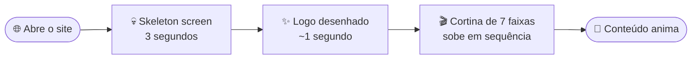
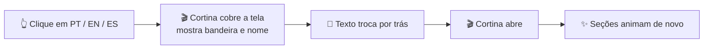

<div align="center">


### ✨ Meu site pessoal: espacial, em vidro e feito à mão ✨

<p>
  
  
  
  
  
</p>

<p>
  
  
  
  
</p>

**[🌐 Ver o site ao vivo](https://www.joaoricardo.space)** &nbsp;·&nbsp; **[🐙 GitHub](https://github.com/0jrpg)** &nbsp;·&nbsp; **[✉️ Contato](mailto:mail@joaoricardo.space)**

</div>

---

## 📑 Sumário

- [🚀 Sobre](#-sobre)
- [🎬 Destaques](#-destaques)
- [🧰 Tecnologias e linguagens](#-tecnologias-e-linguagens)
- [🎞️ Como a página abre](#️-como-a-página-abre)
- [🪄 Técnicas de animação](#-técnicas-de-animação)
- [🌍 Três idiomas](#-três-idiomas)
- [🗂️ Estrutura do projeto](#️-estrutura-do-projeto)
- [☁️ CDN](#️-cdn)
- [♿ Acessibilidade](#-acessibilidade)
- [💻 Rodando localmente](#-rodando-localmente)
- [🎨 Personalizando](#-personalizando)
- [👤 Autor](#-autor)

---

## 🚀 Sobre

Este é o código do meu site pessoal: uma página única (SPA) com tema espacial, vidro translúcido e gradiente **violeta → ciano → menta**.

Tudo foi escrito **sem biblioteca de animação nem de UI**. Cada efeito é CSS moderno ou um hook de React feito aqui mesmo. As únicas dependências de runtime são `react`, `react-dom` e `@vercel/analytics`.

---

## 🎬 Destaques

| | Recurso | O que é |
|:-:|---|---|
| 💀 | **Skeleton screen de 3s** | Esqueleto que imita o layout real, com brilho, barra de progresso e contador de 0 a 100% |
| 🎭 | **Abertura em 3 atos** | Skeleton → logo desenhado em SVG → cortina de 7 faixas que sobe |
| 🌌 | **Fundo vivo** | Céu estrelado em canvas, constelações perto do cursor, estrelas cadentes e aurora flutuante |
| 🔤 | **Texto animado** | Letras que sobem uma a uma, texto digitado em loop e contadores |
| 🧊 | **Cards de vidro** | Spotlight que segue o mouse, inclinação 3D e borda de gradiente girando |
| 🧲 | **Botões magnéticos** | São "puxados" pelo mouse, com ripple e brilho no clique |
| 🖥️ | **Terminal da Alpha** | Digita código `.alf` com sintaxe colorida |
| 🌍 | **PT · EN · ES** | Troca de idioma com cortina animada, sem perder o que foi digitado no formulário |
| 📱 | **Responsivo** | Menu mobile em círculo, cabeçalho que esconde ao rolar, tudo testado até 390px |

---

## 🧰 Tecnologias e linguagens

### 🗣️ Linguagens do código

| Linguagem | Onde é usada | Arquivos | Linhas | % |
|---|---|:-:|:-:|---|
| **TypeScript + JSX (TSX)** | Componentes React | 31 | ~1.540 | `████████████░░░░░░░░` 59% |
| **CSS** | Estilos e animações | 10 | ~600 | `█████░░░░░░░░░░░░░░░` 23% |
| **TypeScript (TS)** | Hooks, dados, i18n, utilitários | 12 | ~430 | `███░░░░░░░░░░░░░░░░░` 16% |
| **JavaScript (ESM)** | Script que baixa a fonte Space Grotesk | 1 | ~30 | `░░░░░░░░░░░░░░░░░░░░` 1% |
| **HTML** | `index.html` (metadados, favicon, preload) | 1 | ~25 | `░░░░░░░░░░░░░░░░░░░░` 1% |

> As linhas do CSS são densas (várias regras por linha), então ele pesa mais do que o número mostra. Valores aproximados, contados em `src/`, `scripts/` e `index.html`.

### 🧱 Ferramentas e bibliotecas

| Tecnologia | Versão | Para quê |
|---|:-:|---|
| ⚛️ **React** | `^18.3` | Interface em componentes e hooks |
| 🔷 **TypeScript** | `^5.6` | Tipagem estrita em todo o projeto |
| ⚡ **Vite** | `^6.0` | Dev server e build |
| 🔌 **@vitejs/plugin-react** | `^4.3` | Suporte a React no Vite |
| 📈 **@vercel/analytics** | `^2.0` | Métricas de acesso |
| 🚢 **Vercel** | n/a | Hospedagem do site |
| ☁️ **CDN próprio** | n/a | Imagens, SVGs e fontes (`cdn.files.joaoricardo.space`) |

### 🔤 Fontes

| Fonte | Uso |
|---|---|
| **Space Grotesk** | Títulos |
| **Inter** | Texto |
| **JetBrains Mono** | Rótulos e código |

---

## 🎞️ Como a página abre



1. **Skeleton (3s):** blocos cinza com shimmer imitam cabeçalho, hero e cards. Uma barra de progresso e um contador sobem até 100%.
2. **Logo:** o anel se desenha em SVG (`stroke-dashoffset`), o "JR" aparece com brilho e o nome do site se abre.
3. **Cortina:** 7 faixas sobem em sequência com uma borda luminosa. No mesmo instante o conteúdo começa a animar.

Enquanto o skeleton está na tela, a página por trás fica com `inert` (sem foco de teclado nem leitor de tela).

Os tempos ficam em `src/data/site.ts`, no objeto `BOOT`.

---

## 🪄 Técnicas de animação

Sem Framer Motion, GSAP nem nada parecido. É a plataforma web pura:

| Técnica | Onde aparece |
|---|---|
| `IntersectionObserver` | Revelações ao rolar, contadores, menu com seção ativa |
| `requestAnimationFrame` | Brilho do cursor, parallax, spotlight dos cards, céu estrelado |
| **Canvas 2D** | `Starfield`: estrelas, constelações e estrelas cadentes |
| `@property` + `conic-gradient` | Borda giratória dos cards, anel do avatar |
| Propriedades `translate` / `scale` / `rotate` | Entrada dos elementos sem brigar com o tilt 3D |
| `perspective()` + `rotateX/Y` | Inclinação 3D dos cards |
| `clip-path: circle()` | Menu mobile que abre como um círculo |
| `background-clip: text` + `-webkit-text-stroke` | Títulos com gradiente e contorno |
| `mask-composite` | Borda de gradiente dos cards |
| `backdrop-filter` | Efeito vidro |
| **Web Animations API** | Partículas ao clicar |
| `matchMedia` | Respeitar `prefers-reduced-motion` |
| **CSS counters** | Numeração de linhas do terminal |

### 🪝 Hooks próprios

`useInView` · `useTyped` · `useTypewriter` · `useCountUp` · `useActiveSection` · `useReducedMotion`

---

## 🌍 Três idiomas

O site fala **Português 🇧🇷, English 🇺🇸 e Español 🇪🇸**. O idioma é detectado pelo navegador e a escolha fica salva.



Os textos ficam em `src/i18n/dictionary.ts`, e o TypeScript garante que os três idiomas tenham exatamente as mesmas chaves.

---

## 🗂️ Estrutura do projeto

```text
src/
├─ 💀 boot/            Abertura: BootProvider (linha do tempo), Boot (overlay), Skeleton
├─ 🧩 components/
│  ├─ 🌌 fx/           Starfield, CursorGlow, BackgroundFX, ScrollProgress, BackToTop, LangTransition
│  ├─ 🧭 layout/       Header, MobileMenu, LangSwitch, SideSocial, Footer
│  ├─ 📄 sections/     Hero, Marquee, Stats, Stack, Projects, Alpha, Contact
│  └─ 🎛️ ui/           Reveal, SplitText, Title, Card, Button, Magnetic, Icons
├─ 🗃️ data/            site (links e tempos), projects, stack
├─ 🪝 hooks/           useInView, useTyped, useTypewriter, useCountUp, useActiveSection, useReducedMotion
├─ 🌍 i18n/            dictionary (PT/EN/ES) + provider
├─ 🔧 lib/             photo (foto com plano B), css (helper de custom properties)
└─ 🎨 styles/          fonts, tokens, base, background, boot, layout, hero, sections, motion
scripts/               baixar-space-grotesk.mjs
```

---

## ☁️ CDN

Todos os arquivos estáticos vêm de `https://cdn.files.joaoricardo.space/<arquivo>`, na raiz, sem pastas. A base está em `src/data/site.ts` (`CDN` e `cdn()`).

<details>
<summary><b>📦 Ver a lista completa de arquivos</b></summary>

<br/>

| Tipo | Arquivos |
|---|---|
| 🖼️ Foto | `joao-ricardo.jpeg` |
| 🌐 Site | `favicon.svg`, `grain.svg` |
| 🚩 Bandeiras | `flag-br.svg`, `flag-us.svg`, `flag-es.svg` |
| 🔣 Ícones | `icon-github`, `icon-mail`, `icon-arrow`, `icon-arrow-up`, `icon-copy`, `icon-check`, `icon-send`, `icon-globe`, `icon-database`, `icon-code` (todos `.svg`) |
| 🔤 Inter | `inter-400.woff`, `inter-500.woff`, `inter-600.woff`, `inter-700.woff` |
| 🔤 JetBrains Mono | `jetbrains-mono-400.woff`, `jetbrains-mono-700.woff` |
| 🔤 Space Grotesk | `space-grotesk-500.woff2`, `space-grotesk-600.woff2`, `space-grotesk-700.woff2` (gerados por `node scripts/baixar-space-grotesk.mjs`) |

</details>

> ⚠️ **CORS:** para o navegador aceitar as **fontes** do CDN, ele precisa responder com `Access-Control-Allow-Origin: *`. Sem isso o site usa a fonte do sistema e continua funcionando. Imagens e ícones (``) não precisam disso.

<details>
<summary><b>🔧 Como ativar o CORS</b></summary>

<br/>

Next.js (`next.config.js` do projeto do CDN):

```js
module.exports = {
  async headers() {
    return [{ source: '/:path*', headers: [{ key: 'Access-Control-Allow-Origin', value: '*' }] }]
  },
}
```

Vercel (`vercel.json`):

```json
{ "headers": [{ "source": "/(.*)", "headers": [{ "key": "Access-Control-Allow-Origin", "value": "*" }] }] }
```

Confira também os tipos servidos: `.svg` → `image/svg+xml`, `.woff` → `font/woff`, `.woff2` → `font/woff2`.

</details>

**Fora do CDN:** o JS e o CSS gerados pelo build (os nomes têm hash e mudam a cada deploy) e o `index.html` ficam na Vercel. Dois SVGs animados ficam inline de propósito: o anel do botão "voltar ao topo" e o logo da abertura.

---

## ♿ Acessibilidade

- 🐢 **`prefers-reduced-motion`**: quem desativa animações no sistema recebe o site sem movimento.
- ⌨️ **`inert`** na página enquanto o skeleton está na tela.
- 🗣️ Título em letras separadas tem versão `sr-only` com o texto inteiro para leitores de tela.
- 🎯 `:focus-visible` com contorno ciano, `aria-label`, `aria-pressed` e `aria-expanded` nos controles.
- 🔔 Avisos (como "E-mail copiado!") usam `role="status"` e `aria-live`.
- 📱 Sem rolagem horizontal no celular.

---

## 💻 Rodando localmente

Precisa de **Node.js 18+**.

```bash
# 1. instalar dependências
npm install

# 2. servidor de desenvolvimento
npm run dev

# 3. build de produção (checa os tipos e gera /dist)
npm run build

# 4. testar o build
npm run preview
```

---

## 🎨 Personalizando

| Quero mudar... | Edite |
|---|---|
| Projetos em destaque | `src/data/projects.ts` |
| Tecnologias da Stack | `src/data/stack.ts` |
| Textos (PT/EN/ES) | `src/i18n/dictionary.ts` |
| Links, e-mail e domínio do CDN | `src/data/site.ts` |
| Tempo do skeleton e da abertura | `BOOT` em `src/data/site.ts` |
| Tempo da animação de idioma | `LANG_FX` em `src/data/site.ts` |
| Cores e fontes | `src/styles/tokens.css` e `src/styles/fonts.css` |
| Foto de perfil | `joao-ricardo.jpeg` no CDN (ou `src/images/` como plano B) |

---

## 👤 Autor

<div align="center">

**João Ricardo Pontes Garbelini**

[](https://github.com/0jrpg)
[](https://www.joaoricardo.space)
[](mailto:mail@joaoricardo.space)

<sub>© João Ricardo Pontes Garbelini. Todos os direitos reservados.</sub>


</div>
